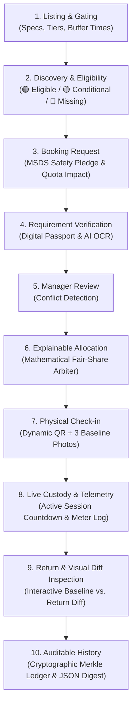

# UniCore — Shared Deep-Tech & Scientific Equipment Exchange Platform

[](https://nextjs.org/)
[](https://www.typescriptlang.org/)
[](https://tailwindcss.com/)
[](https://supabase.com/)
[](https://opensource.org/licenses/MIT)

> **Unlock Underused Scientific Equipment and Spaces**  
> An institutional-grade, cross-university governance, trust, and allocation platform that transforms multi-crore, idle deep-tech instrumentation into accessible, safely shared research infrastructure.

---

## 📌 Executive Summary

Across leading universities, national core facilities, and research incubators, tens of millions of dollars in mission-critical scientific instrumentation—such as Field Emission Scanning Electron Microscopes (FE-SEM), High-Resolution Transmission Electron Microscopes (HR-TEM), X-Ray Diffractometers (XRD), and Femtosecond Laser Spectroscopy rigs—**sit idle for 60% to 75% of their operational life**.

Concurrently, early-stage deep-tech startups, independent researchers, and neighboring academic institutions face insurmountable capital barriers to access these tools.

Generic resource scheduling tools (such as Calendly, Cal.com, or basic university room booking portals) fail completely in this domain because scientific equipment sharing is not a calendar booking problem—it is a **governance, liability, hazard compliance, operator competency, and non-repudiable custody problem**.

**UniCore** solves this challenge by implementing an end-to-end **10-Step Governed Sharing Lifecycle**. It pairs verified researcher credentials with AI-driven prerequisite validation, transparent mathematical conflict arbitration, mobile camera custody handoffs, and side-by-side visual diff return inspections backed by an auditable cryptographic ledger.

---

## 🔬 The Core Problem: Why Traditional Schedulers Fail in Deep-Tech

| Problem in Shared Facilities | Why Generic Booking Schedulers Fail | How UniCore Solves It |
| :--- | :--- | :--- |
| **High Equipment Fragility & Cost** | Any user can pick an open calendar slot, risking \$50,000+ repairs if uncertified. | **Digital Researcher Passport** with AI OCR validation of operating tier certifications. |
| **Hazardous Materials & Contamination** | No sample validation; corrosive acids or volatile bio-hazards ruin vacuum chambers. | **Mandatory MSDS Declaration & Hazard Gating** built directly into the booking flow. |
| **Lab Hoarding & Monopolization** | Well-funded labs book up prime hours weeks ahead without recourse. | **Explainable Conflict Arbiter** enforcing weekly research group quota burn and fair-share scores. |
| **Unattributed Damage Disputes** | "The scratch was already there when I arrived" leads to finger-pointing and locked labs. | **3-Angle Pre-Session Baseline vs. Return Visual Diff** with interactive slider inspection. |
| **Audit & Compliance Vulnerability** | Paper logs or mutable database rows can be backdated or falsified. | **Tamper-Evident SHA-256 Merkle Ledger** with downloadable cryptographic audit digests. |

---

## 🔄 End-to-End Governed Workflow (The 10-Step Lifecycle)

UniCore guides every equipment request through an auditable, ten-stage custody chain:



### Detailed Lifecycle Stages:

1. **Listing & Gating (`/explore/[id]`)**: Facility directors configure instrument capabilities, hazardous substance exclusions, tier prerequisites (e.g., Cleanroom Tier 2, Bio-Safety Level 2), maintenance buffers, and hourly consortium rates.
2. **Discovery & Eligibility (`/explore`)**: Researchers browse instruments with real-time capability filters and live badge indicators:
   - 🟢 **Eligible**: All prerequisites and credentials verified in the user's passport.
   - 🟡 **Conditional Approval**: Safety training verified; requires faculty advisor co-sign or facility orientation.
   - 🔴 **Prerequisites Missing**: Missing required laser safety or vacuum training certificate.
3. **Booking Request & MSDS Safety Declaration**: The borrower selects an available timeslot and is required to submit a chemical/biological Material Safety Data Sheet (MSDS) declaration certifying that no prohibited corrosive or volatile substances will enter the sample chamber.
4. **Requirement Verification via Researcher Passport (`/passport`)**: Borrowers maintain a portable credential profile. Uploading new training certificates triggers multi-modal AI OCR extraction (certifying body, issue date, expiration date, certified tier) and computes an instant credential hash.
5. **Facility Manager Review (`/manager`)**: The facility manager accesses a unified pending queue flagged with priority tiers, institutional affiliation, and any prerequisite discrepancies.
6. **Explainable Conflict Allocation**: When multiple researchers request overlapping slots, UniCore's Fair-Share Arbiter evaluates group quota burn, research milestone urgency, and historical instrument returns. It provides a human-readable mathematical justification for the award decision.
7. **Physical Custody Check-in (`/bookings/[id]/checkin`)**: The borrower arrives at the laboratory and scans a dynamic, time-sensitive machine QR code. The system requires capturing 3 standardized baseline orientation photos (Stage, Objective/Lens, Vacuum/Meter gauge) using a mobile camera or lab upload.
8. **Live Custody & Telemetry HUD (`/bookings` & `/manager`)**: While the instrument is active, a persistent custody HUD displays operating hours, remaining countdown time, and automatic overtime alerts to prevent schedule collisions.
9. **Return & Visual Diff Inspection (`/bookings/[id]/return` & `/manager`)**: Upon session conclusion, the borrower uploads exit condition photos. UniCore runs computer vision visual diffing to detect chamber anomalies, surface abrasions, or residue, presented through an interactive split-view `CompareSlider`.
10. **Tamper-Evident Consortium Audit Ledger (`/admin` & `/bookings/[id]/receipt`)**: Every state transition (booking requested, approved, checked in, inspected, closed) generates a cryptographically hashed ledger event chained into a Merkle root. Users can print verified compliance certificates or download signed JSON audit digests.

---

## 🎭 Interactive Role Personas

To test UniCore seamlessly during evaluations, use the persistent **Persona Switcher** in the top navigation bar:

### 1. Dr. Aris Thorne — External Researcher / Startup Founder
- **Context**: Deep-tech material science founder utilizing cross-campus facilities at IIT Bombay and IISc.
- **Key Flows**: Explores available instruments, uploads safety certificates to the **Researcher Passport**, pledges MSDS compliance, executes physical mobile QR check-in, and completes exit condition photo reviews.
- **Primary Routes**: `/explore`, `/passport`, `/bookings`, `/bookings/[id]/checkin`.

### 2. Prof. Chen — Facility Director & Lab Manager
- **Context**: Primary custodian of the Advanced Materials & Electron Microscopy Core Facility.
- **Key Flows**: Monitors the **Facility Ops Console**, reviews conflicting reservation requests using the **Explainable Conflict Arbiter**, tracks the **Live Custody Telemetry HUD**, and reviews flagged visual anomalies at the **Dispute Resolution Desk**.
- **Primary Route**: `/manager`.

### 3. Dean R. Kulkarni — Consortium Compliance Admin
- **Context**: Institutional oversight administrator governing inter-university asset utilization agreements.
- **Key Flows**: Inspects consortium-wide instrument utilization, tracks cross-campus quota burn, verifies anti-monopoly fair-share compliance, and audits the **Tamper-Evident Merkle State Root**.
- **Primary Route**: `/admin`.

---

## ✨ Key Differentiators & Unique Features

### 1. Digital Researcher Passport with Multi-Modal AI OCR
Researchers no longer need to carry paper certificates or repeatedly re-submit credentials at every lab. UniCore's Passport acts as a sovereign credential wallet. The built-in AI OCR engine automatically parses unstructured PDF/image training certificates, identifies issuing authorities, checks validity windows, and links verified badges directly to equipment access gates.

### 2. Explainable Conflict Arbiter
Traditional platforms either use first-come-first-served (FCFS)—which favors researchers who script reservation bots—or arbitrary managerial discretion. UniCore calculates a deterministic **Fairness Allocation Score**:
$$\text{Score} = w_1 \cdot (1 - \text{QuotaBurn}) + w_2 \cdot \text{MilestonePriority} + w_3 \cdot \text{HistoricalReliability}$$
Every arbitration decision includes a plain-language explanation (e.g., *"Slot awarded to Dr. Thorne because Dr. Mehta's lab has consumed 19 hours of the 20-hour weekly quota, while Dr. Thorne has a scheduled beamtime milestone deadline."*).

### 3. Dual-Angle Visual Diff Return Inspection with Interactive Slider
To eliminate post-session blame, UniCore enforces a visual inspection handoff. High-resolution baseline photos taken at check-in are compared directly against return exit photos using multi-modal computer vision and presented via an interactive side-by-side drag slider (`CompareSlider`). Lab managers can instantly zoom into flagged surface abrasions or contamination marks.

### 4. Dynamic Time-Sensitive QR Tokenization & Geofencing
Equipment cannot be remotely unlocked or falsely marked as used. The physical check-in requires scanning a dynamic HMAC-SHA256 token generated by the physical machine display or terminal, coupled with device geofence coordinates.

### 5. Tamper-Evident Consortium Merkle Ledger
Every lifecycle event is recorded with an immutable SHA-256 hash. The compliance console displays the live Merkle state root, ensuring that neither borrowers nor facility staff can alter past inspection records, safety violations, or overtime logs. Users can download a verified `.json` audit digest or print an institutional-grade compliance certificate.

---

## 🛠️ Complete Technology Stack

```
┌─────────────────────────────────────────────────────────────────────────┐
│                           FRONTEND INTERFACE                            │
│  Next.js 16 (App Router) • React 19 • Tailwind CSS v4 • Base UI/Radix   │
│  Lucide React Icons • Sonner Notifications • Responsive Dark Theme      │
└────────────────────────────────────┬────────────────────────────────────┘
                                     │
┌────────────────────────────────────▼────────────────────────────────────┐
│                         APPLICATION LOGIC & APIS                        │
│  Next.js Route Handlers (Serverless TypeScript)                         │
│  ├── /api/verify-cert       (AI OCR Credential Parsing)                 │
│  ├── /api/diff-inspection   (Computer Vision Visual Diff Engine)        │
│  └── /api/custody/checkin   (HMAC QR Tokenization & Geofence Guard)     │
└────────────────────────────────────┬────────────────────────────────────┘
                                     │
┌────────────────────────────────────▼────────────────────────────────────┐
│                      DATA & GOVERNANCE INFRASTRUCTURE                   │
│  Supabase PostgreSQL with Row Level Security (RLS)                      │
│  ├── tsrange Exclusion Constraints (Zero Double-Booking Guarantee)      │
│  ├── Cryptographic Merkle State Root Auditing                           │
│  └── Resilient Local Optimistic Sync Engine                             │
└─────────────────────────────────────────────────────────────────────────┘
```

- **Framework**: [Next.js 16 (App Router)](https://nextjs.org/) with React Server Components and Server Actions.
- **Styling & Design System**: [Tailwind CSS v4](https://tailwindcss.com/) with an accessible nocturnal palette (`#130b13` background, `#efe5f0` high-contrast text, `#cdaccd` primary, `#70435a` secondary, `#b17c8e` interactive accents).
- **Component Primitives**: Modern unstyled Base UI / Radix primitives with full keyboard navigation and ARIA compliance.
- **Database**: [Supabase PostgreSQL](https://supabase.com/) utilizing native `tsrange` and `gist` exclusion constraints to guarantee zero overlapping reservations at the database level.
- **Vision & AI Engine**: Pluggable multi-modal LLM architecture supporting Google Gemini Flash and OpenAI GPT-4o-mini with deterministic fallback for offline environments.
- **Audit & Cryptography**: Native Web Crypto API for SHA-256 hash chains, HMAC validation, and client-side cryptographic digest generation.

---

## 📁 Repository Directory Structure

```
unicore/
├── app/                              # Next.js App Router Pages & APIs
│   ├── layout.tsx                    # Root layout with Persona switcher & Custody HUD
│   ├── globals.css                   # Tailwind v4 theme variables & print media queries
│   ├── explore/                      # Instrument catalog and capability filtering
│   │   ├── page.tsx
│   │   └── [id]/page.tsx             # Instrument detail, rules, & booking drawer
│   ├── bookings/                     # Researcher bookings & active sessions
│   │   ├── page.tsx
│   │   └── [id]/
│   │       ├── checkin/page.tsx      # QR check-in & 3-angle photo capture
│   │       ├── return/page.tsx       # Return session & visual diff inspection
│   │       └── receipt/page.tsx      # Printable audit certificate & JSON digest
│   ├── passport/page.tsx             # Digital Researcher Passport & OCR verification
│   ├── manager/page.tsx              # Facility Manager console & Explainable Arbiter
│   ├── admin/page.tsx                # Consortium Compliance & Merkle Ledger
│   └── api/                          # Backend API route handlers
│       ├── verify-cert/route.ts      # Multi-modal OCR certificate verification
│       ├── diff-inspection/route.ts  # Computer vision baseline vs return inspection
│       └── custody/checkin/route.ts  # QR custody handoff & geofencing validation
├── components/                       # Modular UI Components
│   ├── app-state.tsx                 # Reactive demo state provider & sync orchestrator
│   ├── explore/                      # Instrument cards, search, & filter facets
│   ├── bookings/                     # Visual diff slider, photo capture, receipt actions
│   ├── passport/                     # Credential badges, upload modal, verification log
│   ├── unicore/                      # Facility manager arbiter, dispute desk, telemetry
│   ├── shell/                        # Persistent header, persona switcher, custody banner
│   └── ui/                           # Badges, buttons, dialogs, sliders, toast notifications
├── lib/                              # Core Utilities & Governance Logic
│   ├── mock-data.ts                  # Comprehensive seed instruments, profiles & logs
│   ├── types.ts                      # Strict TypeScript types across all 10 stages
│   └── supabase/                     # Supabase client, server factory, & sync helpers
├── public/                           # Static assets & sample inspection imagery
│   └── inspection/                   # Baseline and return photographic diff samples
├── supabase/
│   └── schema.sql                    # Production PostgreSQL DDL, RLS policies, & indexes
├── .env.example                      # Environment variables template
├── run-dev.bat                       # 1-click Windows development server launcher
└── run-build.bat                     # 1-click production build verification script
```

---

## 🚀 Quick Start & Local Execution

### Prerequisites
- **Node.js**: Version 20 LTS or higher (`node -v`)
- **Package Manager**: `npm` or `pnpm`

### 1. Clone the Repository
```bash
git clone https://github.com/jainavni1427/UniCore.git
cd UniCore
```

### 2. Install Dependencies
```bash
npm install
```

### 3. Configure Environment Variables (Optional)
Copy `.env.example` to `.env.local`:
```bash
cp .env.example .env.local
```
> **Note**: UniCore includes a fully functional offline simulation engine. If no Supabase or OpenAI/Gemini keys are provided, it automatically uses the deterministic OCR and computer vision mock engines for instantaneous evaluation.

### 4. Run the Development Server
```bash
npm run dev
```
Open **[http://localhost:3000](http://localhost:3000)** in your browser to view the application.

### 5. Production Build Verification
To test the production build:
```bash
npm run build
npm run start
```

---

## 🗄️ Database Setup (Supabase PostgreSQL)

To connect UniCore to a live Supabase project:

1. Create a new project at [database.new](https://database.new).
2. Open the **SQL Editor** in the Supabase Dashboard.
3. Paste and execute the contents of `supabase/schema.sql`.
4. Copy your project URL and anonymous key into `.env.local`:
   ```env
   NEXT_PUBLIC_SUPABASE_URL=https://your-project.supabase.co
   NEXT_PUBLIC_SUPABASE_ANON_KEY=your-anon-key
   ```
5. Restart your development server. All bookings, passport credentials, and inspection logs will automatically synchronize with your PostgreSQL database.

---

## 📜 Concurrency & Safety Guarantee: PostgreSQL Exclusion Constraints

To completely eliminate race conditions and double-bookings during high-concurrency reservation windows, UniCore leverages PostgreSQL's native range operators in `supabase/schema.sql`:

```sql
CREATE TABLE bookings (
    id UUID PRIMARY KEY DEFAULT gen_random_uuid(),
    equipment_id UUID REFERENCES equipment(id) ON DELETE CASCADE,
    booking_range TSRANGE NOT NULL,
    status TEXT NOT NULL DEFAULT 'confirmed',
    EXCLUDE USING gist (
        equipment_id WITH =,
        booking_range WITH &&
    ) WHERE (status IN ('confirmed', 'in_use', 'pending_approval'))
);
```

Any overlapping reservation attempt is rejected at the database engine level with a deterministic exclusion violation, preventing multi-tenant schedule collisions.

---

## 👥 Contributors & Acknowledgements

- **Developed for**: Hackathon Track — *Unlock Underused Equipment and Spaces*
- **Author & Maintainer**: [Avni Jain (@jainavni1427)](https://github.com/jainavni1427)
- **Institution / Consortium**: Designed for inter-university scientific collaboration across premier research institutions.

---

## 📄 License

This project is licensed under the MIT License — see the [LICENSE](LICENSE) file for details.
