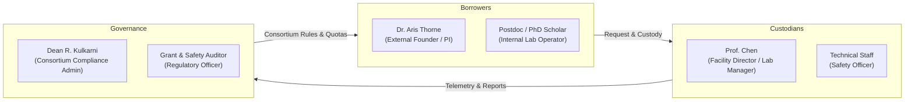
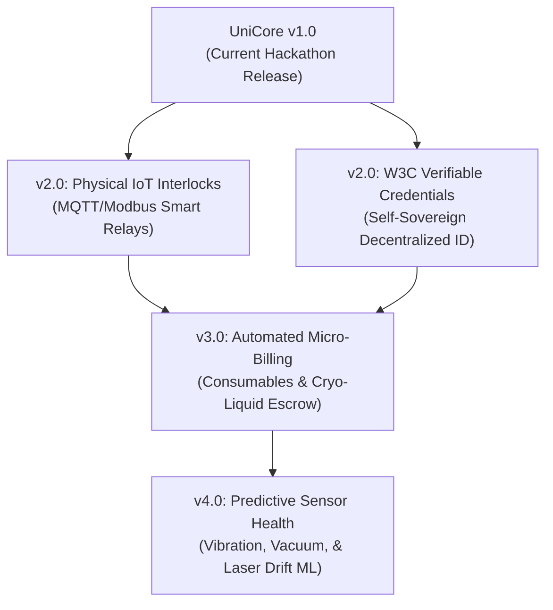

# UniCore — Comprehensive Project Document & Evaluation Dossier

> **Hackathon Track:** Unlock Underused Equipment and Spaces  
> **Project Name:** UniCore (Shared Deep-Tech & Scientific Equipment Exchange Platform)  
> **Repository:** [https://github.com/jainavni1427/UniCore](https://github.com/jainavni1427/UniCore)  
> **Date:** October 2026  

---

## 1. Selected Use Case

### The Domain: High-End Scientific & Deep-Tech Shared Instrumentation
UniCore addresses the sharing, governance, and allocation of **multi-crore, capital-intensive scientific instruments and cleanroom spaces** across research universities, national core facilities, and deep-tech incubators.

Key assets covered under this use case include:
- **Electron & Ion Microscopy:** Field Emission Scanning Electron Microscopes (FE-SEM), High-Resolution Transmission Electron Microscopes (HR-TEM), Focused Ion Beam (FIB) systems.
- **Structural & Surface Characterization:** High-Resolution X-Ray Diffractometers (HR-XRD), Atomic Force Microscopes (AFM), X-Ray Photoelectron Spectrometers (XPS).
- **Spectroscopy & Resonance:** 500MHz–800MHz Nuclear Magnetic Resonance (NMR) spectrometers, Femtosecond Transient Absorption Lasers.
- **Micro/Nano Fabrication Spaces:** ISO Class 5/6 cleanrooms, photolithography aligners, reactive ion etchers (RIE), and thin-film e-beam evaporators.

### Why This Specific Use Case?
Unlike generic asset sharing (e.g., conference rooms, cameras, or co-working desks), scientific equipment represents an extreme frontier of resource sharing:
1. **High Replacement & Repair Costs:** A replacement objective lens or damaged electron gun costs \$25,000 to \$100,000.
2. **Hazardous & Contamination Risks:** Introducing volatile, organic, or corrosive samples into high-vacuum or cleanroom chambers can ruin ongoing research and require weeks of chamber bake-out.
3. **Mandatory Competency Gating:** Only certified operators with proven safety tiers (e.g., Laser Safety Class 4, Bio-Safety Level 2, Radiation Safety) may legally and safely operate these instruments.
4. **Asymmetric Demand:** Morning and afternoon prime slots are aggressively fought over, while night and weekend slots sit completely empty.

---

## 2. Target Users and Resource Owners

UniCore is built around three distinct stakeholder personas interacting within an institutional consortium (e.g., IIT Bombay, IISc Bangalore, TIFR Mumbai, and affiliated deep-tech startups):



### Persona 1: The Borrower (External Researcher / Deep-Tech Founder)
- **Profile:** *Dr. Aris Thorne*, founder of a nanotech semiconductor startup incubated at an adjacent technology park.
- **Needs:** On-demand access to high-end characterization tools (FE-SEM, XRD) without spending millions in seed capital; portable proof of his certified training; transparent booking rules; non-repudiable proof of equipment condition upon return.
- **Pain Points:** Gatekept by host university internal politics; opaque approval delays; paper-based qualification submission at each individual campus; fear of being unfairly blamed for pre-existing scratches or stage misalignment.

### Persona 2: The Resource Owner / Custodian (Facility Director & Lab Manager)
- **Profile:** *Prof. Chen*, Director of the Central Advanced Characterization Facility.
- **Needs:** Safeguarding \$5M+ of sensitive instrumentation; preventing chamber contamination; ensuring zero untrained hands touch lasers or vacuum seals; preventing dominant research groups from monopolizing instruments; fast dispute arbitration.
- **Pain Points:** Drowning in emails and paper logbooks; no objective way to arbitrate scheduling conflicts between competing grants; endless "the scratch was already there" arguments after weekend sessions.

### Persona 3: The Consortium Administrator (Institutional Compliance Admin & Dean)
- **Profile:** *Dean R. Kulkarni*, Head of Inter-Institutional Research Infrastructure.
- **Needs:** Maximizing return on capital and equipment utilization across consortium members; verifying anti-monopoly fair-share rules; enforcing equipment safety audits; generating compliance reports for national funding bodies.
- **Pain Points:** Lack of consolidated telemetry; unable to verify if subsidized equipment is sitting idle or if external revenue sharing is being tracked accurately; lack of tamper-evident audit trails.

---

## 3. Evidence and Reasoning: Why the Problem Matters

### The Economic & Scientific Imperative
1. **The Capital Paradox:**
   - A single modern FE-SEM or HR-TEM costs between **\$1.5M and \$5M**, with annual service maintenance contracts (AMCs) costing **\$80,000 to \$250,000**.
   - Peer-reviewed studies and university equipment audits reveal that academic core equipment has an average **utilization rate of only 25% to 35%**, remaining unused overnight, on weekends, and between university semesters.
   - Meanwhile, over 80% of deep-tech startups in hardware, semiconductors, and advanced materials fail or stall during early-stage prototyping because they cannot afford characterization equipment.
2. **The "Tragedy of the Lab Commons":**
   - When equipment is opened up without structured governance, well-funded "anchor labs" hoard reservations, booking 40-hour blocks that go partially unattended.
   - When unverified external users are permitted access, contamination incidents spike, leading to catastrophic downtime for entire departments.
3. **The Failure of Generic Schedulers:**
   - Standard tools like Google Calendar, Calendly, or Cal.com treat reservations as calendar events. They have **no concept of chemical safety declarations (MSDS), operator competency tiers, custody handoffs, photographic baseline diffing, or anti-monopoly quotas**.
   - Universities revert to manual paper sign-in sheets and locked laboratory doors—the very barrier that keeps utilization depressed.

---

## 4. The Proposed Solution: UniCore

UniCore bridges trust, governance, and access through an institutional-grade platform:

1. **Sovereign Digital Researcher Passport:** Researchers maintain an auditable credential profile where safety training certificates and operational competency tiers are parsed and verified using multi-modal AI OCR.
2. **Hazard-Gated Discovery & Booking:** Instruments display real-time eligibility badges (🟢 Eligible, 🟡 Conditional, 🔴 Prerequisite Missing) matched against the user's passport. Booking requests mandate a structured Material Safety Data Sheet (MSDS) declaration.
3. **Explainable Conflict Arbiter:** Resolves overlapping slot requests using a deterministic, transparent mathematical fairness scoring formula rather than arbitrary bias.
4. **Physical Custody Verification (Dynamic Machine QR & Baseline Capture):** Eliminates ghost bookings and off-site unlocking via dynamic time-sensitive QR codes and mandatory 3-point photographic baseline orientation (Stage, Objective, Gauges).
5. **Multi-Angle Visual Diff Return Inspection:** Uses computer vision and an interactive side-by-side comparison slider (`CompareSlider`) to compare baseline check-in photos with return exit photos, detecting surface anomalies and residues.
6. **Tamper-Evident Consortium Merkle Ledger:** Chains every state change into an immutable cryptographic hash ledger, enabling downloadable verified JSON audit digests and printable compliance certificates.

---

## 5. Complete Product Workflow

UniCore's end-to-end lifecycle follows 10 discrete stages across the borrower, custodian, and auditor:

```mermaid
sequenceDiagram
    autonumber
    actor R as Researcher (Dr. Thorne)
    participant UI as UniCore Platform
    participant AI as AI Engine (OCR & CV Diff)
    actor M as Facility Manager (Prof. Chen)
    participant DB as PostgreSQL Ledger

    Note over R,DB: Stage 1-4: Discovery, Verification & Booking
    R->>UI: Uploads Laser/SEM Cert to Passport
    UI->>AI: /api/verify-cert (Multi-modal OCR)
    AI-->>UI: Verified Tier & Expiry Hash
    R->>UI: Selects Instrument Slot + MSDS Declaration
    UI->>DB: Records Pending Booking with Concurrency Lock

    Note over M,DB: Stage 5-6: Arbitration & Allocation
    M->>UI: Reviews Conflicting Requests
    UI->>UI: Computes Fairness Score (Quota Burn + Milestone)
    M->>UI: Approves Request (Explainable Allocation)
    UI->>DB: Status -> Confirmed

    Note over R,M: Stage 7-8: Physical Custody & Active Session
    R->>UI: Scans Machine Dynamic QR Code
    R->>UI: Captures 3 Baseline Photos (Stage, Objective, Gauge)
    UI->>DB: Session Active; Live Custody Telemetry Initiated

    Note over R,DB: Stage 9-10: Inspection, Dispute Desk & Audit
    R->>UI: Submits 3 Exit Return Photos
    UI->>AI: /api/diff-inspection (Visual Anomaly CV)
    AI-->>UI: Highlighted Anomaly Overlays & Delta Score
    M->>UI: Dispute Desk / One-Click Inspection Sign-off
    UI->>DB: Closes Custody Chain; Updates Merkle State Root
    R->>UI: Downloads Cryptographic Audit Digest & PDF Receipt
```

---

## 6. Features Developed During the Hackathon

| Feature | Description | File / Route Implementation |
| :--- | :--- | :--- |
| **Complete Lovable UI Port & Polish** | Integrated and enhanced complete Lovable frontend with custom nocturnal plum palette (`#efe5f0`, `#130b13`, `#cdaccd`, `#70435a`, `#b17c8e`). | [`app/globals.css`](file:///C:/Users/avni2/.gemini/antigravity/scratch/unicore/app/globals.css), [`components/`](file:///C:/Users/avni2/.gemini/antigravity/scratch/unicore/components) |
| **Interactive Persona Switcher** | Instant toggle between Dr. Aris Thorne (Researcher), Prof. Chen (Manager), and Dean R. Kulkarni (Admin) in the persistent header. | [`components/shell/site-header.tsx`](file:///C:/Users/avni2/.gemini/antigravity/scratch/unicore/components/shell/site-header.tsx) |
| **Dynamic Researcher Passport** | Credential wallet displaying tier badges, issue dates, and automated verification status. | [`app/passport/page.tsx`](file:///C:/Users/avni2/.gemini/antigravity/scratch/unicore/app/passport/page.tsx), [`components/passport/`](file:///C:/Users/avni2/.gemini/antigravity/scratch/unicore/components/passport) |
| **Multi-Modal AI OCR Certificate Extraction** | Serverless route parsing unstructured PDF/image training certificates to extract institution, tier, and dates with SHA-256 hash. | [`app/api/verify-cert/route.ts`](file:///C:/Users/avni2/.gemini/antigravity/scratch/unicore/app/api/verify-cert/route.ts) |
| **Explainable Conflict Arbiter** | Facility manager interface ranking conflicting reservations with plain-language mathematical justification. | [`app/manager/page.tsx`](file:///C:/Users/avni2/.gemini/antigravity/scratch/unicore/app/manager/page.tsx), [`components/unicore/`](file:///C:/Users/avni2/.gemini/antigravity/scratch/unicore/components/unicore) |
| **Dynamic QR & Geofence Check-in** | Machine-side HMAC QR token generator and mobile check-in verification preventing proxy check-ins. | [`app/bookings/[id]/checkin/page.tsx`](file:///C:/Users/avni2/.gemini/antigravity/scratch/unicore/app/bookings/[id]/checkin/page.tsx), [`app/api/custody/checkin/route.ts`](file:///C:/Users/avni2/.gemini/antigravity/scratch/unicore/app/api/custody/checkin/route.ts) |
| **Physical Camera Photo Capture** | Integrated mobile camera capture `<input type="file" accept="image/*" capture="environment">` with live preview and simulation fallback. | [`components/bookings/photo-capture.tsx`](file:///C:/Users/avni2/.gemini/antigravity/scratch/unicore/components/bookings/photo-capture.tsx) |
| **Visual Diff Return Inspection** | Interactive side-by-side drag slider (`CompareSlider`) pairing baseline vs. return imagery with multi-modal CV anomaly detection. | [`components/unicore/compare-slider.tsx`](file:///C:/Users/avni2/.gemini/antigravity/scratch/unicore/components/unicore/compare-slider.tsx), [`app/api/diff-inspection/route.ts`](file:///C:/Users/avni2/.gemini/antigravity/scratch/unicore/app/api/diff-inspection/route.ts) |
| **Live Custody Telemetry HUD** | Persistent banner tracking active equipment time, remaining countdown, and overdue alerts. | [`components/shell/custody-banner.tsx`](file:///C:/Users/avni2/.gemini/antigravity/scratch/unicore/components/shell/custody-banner.tsx) |
| **Facility Dispute Desk** | Human-in-the-loop manager resolution desk offering 1-click verdicts (Normal Wear, Mandatory Skill Refresh, Escrow Damage Claim). | [`app/manager/page.tsx`](file:///C:/Users/avni2/.gemini/antigravity/scratch/unicore/app/manager/page.tsx) |
| **Tamper-Evident Merkle Audit Ledger** | Cryptographic hash chaining verifying log integrity across cross-campus consortia. | [`app/admin/page.tsx`](file:///C:/Users/avni2/.gemini/antigravity/scratch/unicore/app/admin/page.tsx), [`components/unicore/custody-ledger.tsx`](file:///C:/Users/avni2/.gemini/antigravity/scratch/unicore/components/unicore/custody-ledger.tsx) |
| **Cryptographic Digest Export & Printable Certificate** | Downloadable `.json` cryptographic digest and CSS `@media print` formatted official compliance certificates. | [`components/bookings/receipt-actions.tsx`](file:///C:/Users/avni2/.gemini/antigravity/scratch/unicore/components/bookings/receipt-actions.tsx), [`app/bookings/[id]/receipt/page.tsx`](file:///C:/Users/avni2/.gemini/antigravity/scratch/unicore/app/bookings/[id]/receipt/page.tsx) |
| **PostgreSQL Concurrency Schema with RLS** | Production-ready Supabase schema using `tsrange` and `gist` exclusion constraints to mathematically prevent double bookings. | [`supabase/schema.sql`](file:///C:/Users/avni2/.gemini/antigravity/scratch/unicore/supabase/schema.sql) |

---

## 7. Technology Stack and System Architecture

### Architectural Topology

```
┌────────────────────────────────────────────────────────────────────────┐
│                          PRESENTATION LAYER                            │
│  Next.js 16.4.3 (App Router) • React 19 • Tailwind CSS v4             │
│  Base UI / Radix UI Primitives • Lucide React • Sonner Toasts          │
└───────────────────────────────────┬────────────────────────────────────┘
                                    │
┌───────────────────────────────────▼────────────────────────────────────┐
│                        API & ORCHESTRATION LAYER                       │
│  Next.js Serverless Route Handlers (TypeScript)                        │
│  ├── /api/verify-cert      -> Multi-modal OCR Extraction               │
│  ├── /api/diff-inspection  -> Baseline vs. Return Anomaly Detector     │
│  └── /api/custody/checkin  -> HMAC Dynamic QR & Geofence Validator     │
└──────────────────┬─────────────────────────────────┬───────────────────┘
                   │                                 │
┌──────────────────▼───────────────┐ ┌───────────────▼───────────────────┐
│        AI & VISION ENGINE        │ │       DATA & CRYPTO LEDGER        │
│  Google Gemini 1.5 Flash         │ │  Supabase PostgreSQL              │
│  / OpenAI GPT-4o-mini            │ │  ├── TSRANGE Exclusion Guards     │
│  (with deterministic fallback)   │ │  ├── Row Level Security (RLS)     │
│                                  │ │  └── SHA-256 Merkle State Root    │
└──────────────────────────────────┘ └───────────────────────────────────┘
```

### Detailed Component Stack:
- **Framework:** Next.js 16.4.3 (Turbopack engine, App Router architecture).
- **Core Library:** React 19 with Server Components, Actions, and optimistic state.
- **Language:** TypeScript 5.7.3 with strict type-safety across all 10 lifecycle stages (`lib/types.ts`).
- **Styling:** Tailwind CSS v4 utilizing CSS custom property tokens and `@theme inline` configuration.
- **UI Components:** Unstyled accessible primitives from `@base-ui/react` and Radix UI.
- **State Management:** Custom React Context `AppStateProvider` with optimistic local state and background Supabase synchronization (`lib/supabase/sync.ts`).
- **Database:** PostgreSQL on Supabase with `btree_gist` extension, `tsrange` exclusion constraints, and granular RLS policies.
- **Cryptography:** Native Web Crypto API for SHA-256 hash chaining, dynamic HMAC tokens, and Merkle root calculations.

---

## 8. AI Tools, APIs, Frameworks, and External Services Used

### 1. Multi-Modal AI OCR Engine (`/api/verify-cert`)
- **Primary Model:** Google Gemini 1.5 Flash (`gemini-1.5-flash`) via the Google AI SDK / REST API.
- **Alternative Model:** OpenAI GPT-4o-mini (`gpt-4o-mini`).
- **Function:** Parses unstructured certificates (safety credentials, laser handling, cleanroom protocol) into structured JSON schema:
  ```json
  {
    "certification_name": "Laser Safety Officer (LSO) Class 4",
    "issuing_body": "TIFR Advanced Center",
    "valid_until": "2027-12-31",
    "tier_level": "Tier 3 Specialist",
    "credential_hash": "sha256-a9f8b2..."
  }
  ```
- **Resilience Strategy:** Deterministic regex heuristic engine fallback for completely offline or key-less demonstration environments.

### 2. Computer Vision Visual Diff Anomaly Engine (`/api/diff-inspection`)
- **Primary Model:** Multi-modal vision API (Gemini Vision / GPT-4o-mini vision).
- **Function:** Analyzes dual-image inputs (check-in baseline vs. return photo) taken at identical camera orientation angles (Stage, Objective, Gauges).
- **Output:** Returns normalized bounding box coordinates for detected surface abrasions, stage misalignment, or chamber residue, along with a confidence delta score.
- **Interactive UI:** Feeds directly into UniCore's `CompareSlider` component for human-in-the-loop verification.

### 3. Supabase Managed PostgreSQL
- Utilized for real-time synchronization, Row Level Security (RLS), and database-level temporal range exclusion (`EXCLUDE USING gist (equipment_id WITH =, booking_range WITH &&)`).

---

## 9. Privacy, Security, and Fairness Considerations

### 1. Concurrency & Race-Condition Security
- Traditional web apps perform a `SELECT ... WHERE overlap` followed by an `INSERT`, creating a critical race condition under high concurrency.
- UniCore offloads scheduling concurrency to PostgreSQL's native `tsrange` exclusion constraint. The database engine rejects any microsecond-overlapping reservation deterministically, guaranteeing zero double-bookings.

### 2. Privacy & Credential Data Protection
- Personal Identifiable Information (PII) on training certificates (such as personal phone numbers or academic registration IDs) is discarded during OCR parsing; only the certificate title, certified tier, issuing body, validity period, and a SHA-256 fingerprint are stored in the public ledger.
- Passports belong to the researcher, allowing cross-institutional verification without exposing private research grants or internal student records.

### 3. Non-Repudiable Custody & Anti-Tampering
- Equipment cannot be unlocked remotely or falsely marked as returned.
- Dynamic QR codes are generated with time-bounded HMAC-SHA256 tokens that expire every 60 seconds, validated against lab terminal timestamps and device GPS geofence radius.
- Every state transition is recorded as an immutable hash event in `audit_ledger`, preventing malicious backdating or record manipulation by facility staff.

### 4. Algorithmic Fairness & Anti-Hoarding
UniCore replaces arbitrary managerial favor with a transparent, mathematical **Fairness Allocation Score**:

$$\text{Fairness Score} = 0.40 \times (1 - \text{QuotaBurn}) + 0.35 \times \text{MilestoneUrgency} + 0.25 \times \text{Reliability}$$

- **Quota Burn:** Measures the fraction of the research group's weekly allowance already consumed.
- **Milestone Urgency:** Verified grant milestone or thesis beamtime deadline.
- **Reliability:** Historical score factoring on-time returns and clean inspection sign-offs.
- Every arbitration output contains a plain-English explanation shown transparently to both the winning and losing researchers, eliminating friction and perceived bias.

---

## 10. Known Limitations

1. **Hardware Interlock Integration:**
   - In its current software prototype, UniCore relies on software-driven dynamic QR tokens and mobile photo verification. It does not yet connect directly to physical electrical relays (e.g., Modbus/SCADA or IoT smart interlocks) that physically cut high-voltage power to instrument electron guns.
2. **Camera Lighting & Angle Variance:**
   - While the mobile photo capture guide enforces standardized angles (Stage, Objective, Gauge), variations in laboratory ambient lighting or smartphone focal lengths can introduce noise into computer vision diffing. Human-in-the-loop dispute desk review remains essential.
3. **Offline Demo Fallback vs. Live Cloud:**
   - When running without live cloud API keys, the OCR and Visual Diff engines use deterministic simulation models. While identical in UI and output structure, real-world deployment requires provisioned Google Gemini or OpenAI API keys.

---

## 11. Future Development Possibilities



1. **IoT Hardware Interlocks & Smart Relay Integration:**
   - Deploying Raspberry Pi / ESP32 gateways connected via MQTT or Modbus to physical equipment power circuits. The instrument remains de-energized until the dynamic QR code is scanned and verified.
2. **W3C Verifiable Credentials & Decentralized ID (DID):**
   - Upgrading the Researcher Passport into an internationally recognized self-sovereign credential compliant with W3C Verifiable Credential standards, allowing researchers from international universities (e.g., MIT, Stanford, Oxford) to present cryptographically signed safety credentials instantly.
3. **Automated Escrow & Consumables Micro-Billing:**
   - Smart-contract or Stripe/Razorpay escrow integration to automatically charge for consumable utilization (e.g., liters of liquid helium, sputtering gold target wear, or laser tube operating hours) upon inspection completion.
4. **Predictive Maintenance & Acoustic Telemetry:**
   - Ingesting operational telemetry (turbo-pump vibration spectra, chamber vacuum pressure logs, chiller temperature) into machine learning models to detect instrument degradation before catastrophic failure occurs.

---

## 12. Summary & Verification

UniCore provides a complete, working solution to the **Unlock Underused Equipment and Spaces** challenge. By replacing informal, fragile trust models with verified credentials, transparent arbitration, photographic baseline diffing, and an immutable cryptographic audit ledger, UniCore transforms millions of dollars of stranded scientific infrastructure into a vibrant, collaborative research engine.

- **Local Working Prototype:** [http://localhost:3000](http://localhost:3000)
- **GitHub Repository:** [https://github.com/jainavni1427/UniCore](https://github.com/jainavni1427/UniCore)
- **Database DDL & Schema:** [`supabase/schema.sql`](file:///C:/Users/avni2/.gemini/antigravity/scratch/unicore/supabase/schema.sql)
